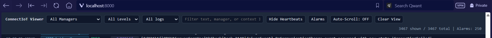


# ConnectIoT Log Viewer

Real-time FastAPI log viewer for ConnectIoT with Manager ID and other filtering capabilties, configurable alarm rules, and auto-tailing.

## Header



## Log body


## Run

``````bash
pip install fastapi uvicorn
python viewer.py

