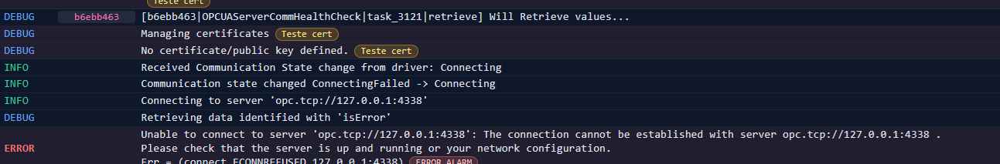


# ConnectIoT Log Viewer

Real-time FastAPI log viewer for ConnectIoT with `managerId` filtering, alarm rules, and auto-tailing.

## Run

``````bash
pip install fastapi uvicorn
python viewer.py

## Interface

### Header and Controls


### Log Stream View

